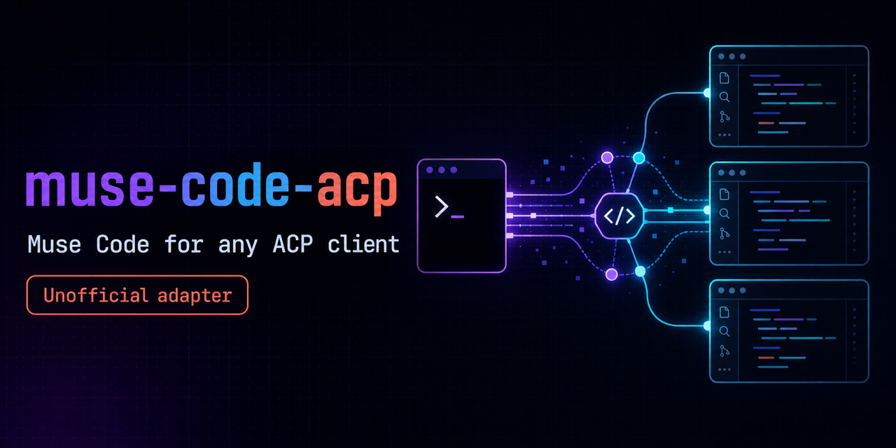

<div align="center">



# Use Muse Code inside Zed — and any ACP editor

**`muse-code-acp`** connects [Muse Code](https://dev.meta.ai/docs/muse-code/) to [Agent Client Protocol (ACP)](https://agentclientprotocol.com) clients like **Zed** and **VS Code with an ACP extension**, so you get streamed tool calls, editor-native permissions, plan mode, sessions, MCP, and slash-command workflows — without leaving your editor.

[](https://www.npmjs.com/package/@bex-co/muse-code-acp)
[](https://www.npmjs.com/package/@bex-co/muse-code-acp)
[](https://github.com/bex-co/muse-code-acp/actions/workflows/ci.yml)
[](LICENSE)
[](package.json)

[**⚡ Quickstart**](#quickstart) ·
[**✨ Features**](#features) ·
[**🏗️ How it works**](#how-it-works) ·
[**📖 Docs**](docs/capability-audit.md) ·
[**⭐ Star on GitHub**](https://github.com/bex-co/muse-code-acp)

```sh
npm install -g @bex-co/muse-code-acp
```

</div>

> **Unofficial adapter.** Muse Code and Muse Spark are products of Meta Platforms, Inc. This community project is not affiliated with, endorsed by, or supported by Meta. You install Muse separately — this package does not bundle the Muse executable.

---

## 💡 Why developers use it

Coding agents are only useful where you actually write code. `muse-code-acp` brings Muse into the editor surface ACP was designed for:

- **Stay in your editor** — streamed replies, tool calls, diffs, and permission prompts render natively in Zed / your ACP client, not in a separate terminal UI.
- **Keep control** — Default, Read-only, and guarded Plan modes; every approval is a host-offered choice routed through ACP and fails closed on cancel or stale replies.
- **Keep your sessions** — list, load full history, resume without replay, close, and natively fork Muse sessions from the client.
- **Bring your tools** — client-provided MCP servers (stdio + HTTP), images and embedded context, model switching, skills, planning, Git reviews, and goals.
- **Trust what's verified** — behavior is pinned to a verified Muse host, covered by deterministic contract tests plus required real-host loopback suites in CI. Limits are stated plainly below, never hidden.

> ⭐ **If this saves you setup time, star the repo** — it helps other ACP + Muse users find it, and [open an issue](https://github.com/bex-co/muse-code-acp/issues) with your editor + Muse version when something breaks.

<a id="features"></a>

## ✨ What you get

On the default SDK backend with the verified host:

| You get              | Details                                                                                                                      |
| -------------------- | ---------------------------------------------------------------------------------------------------------------------------- |
| 💬 Streamed agent    | Text, tool calls/results, cancellation, multi-turn continuity                                                                |
| 🖼️ Rich context      | PNG/JPEG/GIF/WebP images, resource links, embedded text (audio/binary resources unsupported)                                 |
| 🧭 Sessions          | Paginated list, full history load, resume without replay, close, native fork                                                 |
| 🔐 Permissions       | Interactive host-offered choices via ACP; cancel/stale replies fail closed                                                   |
| 🎛️ Modes & models    | Default / Read-only / Plan; provider- and profile-qualified model catalogs, `/models` refresh, verified idle model switching |
| 🔌 MCP               | Client stdio + HTTP servers, with local config/last-failure diagnostics                                                      |
| 📝 File changes      | Bounded observed diffs; optional negotiated reports mark partial coverage                                                    |
| ⚡ Slash workflows   | Skills as slash commands, `/plan`, `/review`, goals, and more (below)                                                        |
| 🎯 Goals             | Goal status; native `/goal set\|edit\|pause\|resume\|clear` on Muse 1.4.6+                                                   |
| ↪️ Mid-turn steering | When explicitly negotiated by the client                                                                                     |

### Slash commands worth trying first

Slash commands can appear in any top-level text block alongside editor context.

| Command                                  | Try it for                                                                     |
| ---------------------------------------- | ------------------------------------------------------------------------------ |
| `/plan <task>`                           | Guarded planning first; `/plan` alone enables Plan mode without starting       |
| `/review <focus>`                        | Git review with focus instructions; attachments preserved                      |
| `/goal <task>`                           | Run a task once; `/goal set <objective>` for a persistent native goal (1.4.6+) |
| `/models`                                | Refresh the model catalog before a turn                                        |
| `/recap` · `/rename`                     | Native session recap / rename on Muse 1.4.7+                                   |
| `/skills` · `/plugins` · `/hooks`        | Inspect, enable/disable, and import skills; list/install plugins (1.4.7+)      |
| `/status` · `/mcp <question>`            | Session + subscription usage; MCP diagnostics combined with a normal task      |
| `/feedback bug\|bad\|good\|other <note>` | Send feedback to Muse (session record only with `--with-session`)              |

<details>
<summary><strong>Full slash-command notes</strong></summary>

On Muse 1.4.7 or newer, `/recap` asks Muse for a short recap of the session (a model side-call that adds nothing to history) and `/rename` also sets Muse's own session name. `/skills enable|disable <skill>` changes a skill's activation in the scope it comes from, `/skills import claude|codex` previews importing foreign skills (`--apply` imports), and `/feedback bug|bad|good|other <note>` sends feedback to Muse with no files attached (the session record only with `--with-session`). `/status` also shows Muse's own subscription usage when Muse reports it. `/plugins` and `/hooks` list installed Muse plugins and hooks, and `/plugins install <folder>` installs a local plugin, only on that explicit command.

Planning and review preserve attachments. `/goal <task>` runs the task once without creating a goal; `/goal set <objective>`, `edit`, `pause`, `resume` and `clear` control Muse's native goal on Muse 1.4.6 or newer (see [goal controls](docs/goal-extension.md#native-goal-controls)). Local status queries do not send attachments to a model; an additional explicit task is handled after the status response. `/mcp <question>` combines local diagnostics with a normal task in the current mode, without claiming native MCP control.

</details>

> **Honest limits:** delegated workers and token usage are reported as unavailable. Reasoning summaries, editor-side filesystem proxying, multiple authorized workspace roots, and native session deletion are not implemented. Closing a session retains its native history. This adapter does not implement every ACP feature or every feature of Muse's terminal UI. Available features also depend on your ACP client.

<a id="quickstart"></a>

## ⚡ Quickstart — about 60 seconds

**Prerequisites**

- [ ] **Node.js 22+**
- [ ] **Muse Code 1.1.1-R2514.1** (verified host, installed separately, with `muse serve`) — the latest Muse installer may install a different version, so pin the binary with `MUSE_CODE_EXECUTABLE` (see [Compatibility](#compatibility))
- [ ] Muse auth via browser login **or** `META_API_KEY`

```sh
export MUSE_CODE_EXECUTABLE="/absolute/path/to/muse-1.1.1"
"$MUSE_CODE_EXECUTABLE" --version
"$MUSE_CODE_EXECUTABLE" serve --help
"$MUSE_CODE_EXECUTABLE" login
npm install -g @bex-co/muse-code-acp
muse-code-acp --version
```

For headless use, provide `META_API_KEY` to the adapter process instead of browser login. The adapter speaks ACP over stdio — launch it through your editor, not as an interactive terminal chat.

### Zed

Add a [custom external agent](https://zed.dev/docs/ai/external-agents#custom-agents) to your Zed settings, replacing the Muse path:

```json
{
  "agent_servers": {
    "Muse Code": {
      "type": "custom",
      "command": "muse-code-acp",
      "args": [],
      "env": {
        "MUSE_CODE_EXECUTABLE": "/absolute/path/to/muse-1.1.1"
      }
    }
  }
}
```

Then select **Muse Code** in Zed's Agent Panel and send your first prompt — try `/plan explain this repo` to see Plan mode in action.

> **Tip — GUI apps don't inherit your shell.** Set `MUSE_CODE_EXECUTABLE` (and `META_API_KEY`, if used) in the editor config even if you exported them in a terminal. If Zed cannot find `muse-code-acp`, use its absolute path as `command`; Node must also be available to the editor.

**Other ACP clients** use the same `command` and `env`. Browser login inside a client requires terminal-auth support; otherwise authenticate beforehand.

<a id="how-it-works"></a>

## 🏗️ How it works

```text
Zed / VS Code (ACP client)
        ↕  ACP over stdio
muse-code-acp  (this adapter)
        ↕  official Muse SDK (@muse-code/sdk, pinned)
muse serve  (MSP)  →  native sessions, tools, sandbox, models
```

The official [Muse SDK](https://github.com/meta-models/muse-code-sdk) communicates with `muse serve` over MSP. The adapter starts or resumes native sessions, translates message/tool items into ACP updates, routes permission requests to the client, and cancels using `turn/cancel`. Native execution, model access, persistence, and sandboxing remain owned by Muse.

- **Modes, two ways in sync.** Mode selection works through ACP config options and the legacy session-mode interface; changing either keeps both synchronized, and `/plan` updates the mode selector. SDK sessions offer Default, Read-only, and Plan. These are not Codex's "Approve for me" or "Full access" presets — native automatic approval has not been verified on the supported host (`allowAll` was accepted in isolated tests, but a shell write still required a decision). Remaining approvals are forwarded, never auto-granted.
- **Session hosts.** Each SDK session can retain its host across compatible turns. Idle hosts expire after 60 seconds; session close also releases them. Close a session before moving its native conversation to another client. Listing uses public `session/list` with bounded pagination; full history replay uses validated `muse export`; read-only store helpers remain for compatibility lookups and title fallback. Indexes are eventually consistent, so a new session may not appear immediately.

<details>
<summary><strong>Permissions deep dive: multi-stage approvals, stalls, and session state</strong></summary>

A shell command can need more than one approval: Muse splits a compound command into stages and asks about each one that is not already known-safe. The adapter decides every stage from the host's latest published requirement, so one tool call produces one permission request per unresolved stage and runs only after the last decision. Denying any stage cancels the whole command. Only choices the host offered are ever submitted. Each multi-stage prompt shows the current stage's host-published arguments and position, such as `Stage 3 of 4: echo two`, even without a Muse extension. The total includes known-safe stages, not just dialogs. The full command remains available in the request; the adapter does not parse shell text to invent a stage. Single-stage prompts keep their existing titles.

If the host stops making progress on a request the adapter owes it an answer to, the turn fails after `MUSE_CODE_ACP_STALL_MS` with the approval, requirement and stage evidence, rather than waiting indefinitely. Clients also receive a `muse/hostCompatibility` entry on `session_info_update` once per host, carrying the pinned and served schema fingerprints and the detected host version; a mismatch is advisory and never blocks a session.

Clients can opt into `muse/sessionState` to receive observed host model and approval-mode changes, plus verified or explicitly unverified persistent-rule outcomes. These reports do not change ACP configuration or permission policy. See [observed session state](docs/sdk-migration.md#observed-session-state-w2006).

</details>

<details>
<summary><strong>Approval and sandbox controls</strong></summary>

SDK `bypassApprovals` automatically selects only host-offered once approvals at all stages, with no ACP dialogs or persistent grants. `rejectApprovals` rejects pending prompts using offered once-denial choices; known-safe tools can still run. Both work on Muse 1.1.1 and 1.2.1. Select them using either `session/set_mode` or `session/set_config_option` with `configId: "mode"`.

Separate SDK config options select `nativeApprovalPolicy`, `sandbox`, `sandboxNetwork`, `workspaceWrite` and `shell`. Defaults remain prompted `onRequest`, sandbox enabled, proxy-only network, writes and shell enabled. Non-default native policies require Muse 1.2.1+; automatic once decisions work on 1.1.1 without those policies. Disabling the sandbox additionally requires `MUSE_CODE_ACP_ALLOW_YOLO=1`. No SDK option implicitly trusts workspace rules.

Changes require an idle session and replace its retained host. Load/resume restore validated preferences; fork resets safety settings and modes. See the [policy matrix and platform limits](docs/sdk-migration.md#approval-and-sandbox-settings).

</details>

<details>
<summary><strong>Legacy exec backend (rollback)</strong></summary>

```sh
MUSE_CODE_ACP_BACKEND=exec muse-code-acp
```

The legacy backend runs `muse exec --json` per turn. It supports the echo provider, uses store-based session listing and accepts stdio MCP servers only. Approvals resolve inside Muse rather than through interactive ACP permissions. Default, read-only and bypass-approvals modes are available; advertising yolo requires `MUSE_CODE_ACP_ALLOW_YOLO=1`.

SDK failures never silently switch to exec. The legacy backend was introduced for Muse 0.2.1; this release's integration baseline remains 1.1.1-R2514.1.

</details>

<a id="compatibility"></a>

## 🧩 Compatibility

| Piece               | Verified / required                                                                               |
| ------------------- | ------------------------------------------------------------------------------------------------- |
| Node.js             | **22+** (npm install)                                                                             |
| Muse host           | **1.1.1-R2514.1** baseline (`muse serve`); select via `MUSE_CODE_EXECUTABLE`                      |
| Also verified       | 1.2.1-R2847.1 (session load/resume, multi-stage allow/deny, HTTP MCP); CI also runs 1.4.8-R6256.1 |
| Muse SDK            | `@muse-code/sdk@1.4.8` (pinned dependency; does not include the Muse binary)                      |
| Newer-host features | Native goals 1.4.6+; `/recap`, skills import, plugins/hooks 1.4.7+                                |
| Auth                | Browser login or `META_API_KEY`                                                                   |

> **Keep the default SDK backend when sessions must stay resumable on hosts before 1.4.6** — see the `:auto-review` note below. Don't point `MUSE_CODE_EXECUTABLE` at an old launcher cache (the launcher removes superseded binaries); keep the verified binary at a separate path. CI's public 1.1.1 artifacts, exact macOS ARM64/Linux URLs, and SHA-256 checks are in [CI](.github/workflows/ci.yml).

<details>
<summary><strong>Full compatibility history (1.2.1 – 1.4.6, :auto-review, exec stalls)</strong></summary>

**The supported baseline remains Muse 1.1.1-R2514.1** (verified host for adapter **0.5.x**). Adapter **0.5.0** also verifies SDK-created session load/resume, multi-stage allow/deny, and HTTP MCP tool calls and startup failures on **1.2.1-R2847.1**. ACP-provided MCP servers explicitly use required startup mode; authentication, malformed responses and unreachable endpoints fail the prompt.

One host limitation remains on 1.2.1, 1.3.0, 1.4.3 and 1.4.4: legacy `muse exec` sessions saved with `:auto-review` cannot be resumed in `muse serve`, whose automated reviewer is unavailable. From 1.3.0-R3401.1 the host also refuses to read them, so ACP `session/load` fails with the same message instead of replaying history. From 1.4.3 `muse exec` saves new sessions with `:auto-review` by default, so new sessions from the opt-in exec backend are affected too. From 1.4.4, exec-backend Read-only and Plan sessions use Muse's built-in `:read-only` profile and stay loadable; Default mode keeps `:auto-review`, because the loadable alternative would run tools without approval (upstream: [muse-code-sdk#80](https://github.com/meta-models/muse-code-sdk/issues/80)).

Muse 1.4.6 runs its automated reviewer in `muse serve` too, and loads and continues these sessions; on earlier hosts, **keep the default SDK backend when sessions must stay resumable.** On 1.4.6 the reviewer also decides SDK-backend approval requests first: low-risk calls it approves run without an ACP permission prompt, and only escalations reach the client. In exec Default mode, a tool call that Muse's reviewer escalates to a user cannot be answered headlessly; the adapter stops the run after 120 seconds (`MUSE_CODE_ACP_EXEC_APPROVAL_STALL_MS`) and fails the prompt with that reason instead of hanging ([muse-code-sdk#99](https://github.com/meta-models/muse-code-sdk/issues/99)). This affects the legacy-continuation portion of three live tests; SDK-created session continuation passes. The adapter reports an actionable error and does not replay the prompt or change the saved permission profile. Start a new ACP session or continue the old one in Muse with reviewer support. These fixes are included in **0.5.0**.

Stored full tool output on Muse 1.2.1 is available to negotiated clients through [bounded public output reads](docs/stored-output.md), including after session load. For slow SDK startup, configure the [startup and submission deadlines](docs/failures.md#startup-phases-and-deadlines). Failure responses distinguish operations that submitted no model turn from submissions with an unknown outcome.

</details>

## ⚙️ Configuration

| Variable                    | Meaning                                                                |
| --------------------------- | ---------------------------------------------------------------------- |
| `MUSE_CODE_EXECUTABLE`      | Path to the external Muse binary; takes precedence over PATH discovery |
| `MUSE_CODE_ACP_BACKEND`     | `sdk` (default) or `exec`; unknown values fail at startup              |
| `META_API_KEY`              | Provider credential; takes priority over stored auth                   |
| `MUSE_CODE_ACP_ALLOW_YOLO`  | Opt in to exec yolo or separately selected SDK sandbox-off             |
| `MUSE_AGENT_LOGS`           | Directory for adapter spawn/stderr logs                                |
| `MUSE_CODE_ACP_STALL_MS`    | Stall bound for pending host requests, default `10000` (SDK backend)   |
| `MUSE_CODE_ACP_GATEWAY_URL` | Explicit model gateway endpoint; requires `MUSE_CODE_ACP_GATEWAY_KEY`  |
| `MUSE_CODE_ACP_GATEWAY_KEY` | Bearer token for that gateway; never persisted                         |

`muse-code-acp --cli login` and `muse-code-acp --cli logout` delegate to the selected Muse executable. Logout does not unset an exported `META_API_KEY`.

## ❓ FAQ

**Zed says `muse-code-acp` not found?**
Use the absolute path to the installed binary as `command`, and make sure Node 22+ is available to the editor process (GUI apps may not inherit your shell `PATH`).

**It worked in the terminal but not in the editor?**
Set `MUSE_CODE_EXECUTABLE` (and `META_API_KEY` if you use it) inside the editor's agent `env`, not only in your shell.

**Which Muse version should I actually run?**
Pin **1.1.1-R2514.1** unless you need a documented newer-host feature. Check with `"$MUSE_CODE_EXECUTABLE" --version`. Newer hosts are verified for specific surfaces — see [Compatibility](#compatibility).

**Headless / CI auth?**
Provide `META_API_KEY` to the adapter process. Browser login inside a client needs terminal-auth support; otherwise run `muse login` (or `muse-code-acp --cli login`) beforehand.

**SDK or exec backend?**
Stay on the default SDK backend. The exec backend is a rollback path only (stdio MCP only, approvals resolved inside Muse, `:auto-review` resumability caveats before 1.4.6). SDK failures never silently fall back to exec.

## 📖 Documentation

**Start here**

- [Capability evidence and current ownership](docs/capability-audit.md)
- [Observed usage, plans, summaries and tool output](docs/progress.md)
- [Failure and authentication observations](docs/failures.md) — structured SDK errors, credentials, startup deadlines, recovery

**Sessions & workflows**

- [Session discovery and metadata](docs/session-discovery.md) · [Native session branching](docs/session-fork.md) · [Embedded input and local session commands](docs/session-commands.md)
- [Planning and Git reviews](docs/workflows.md) · [Goal observation & controls](docs/goal-extension.md) · [Workflow and background tasks](docs/async-tasks.md)

**Protocol & internals**

- [SDK support, model discovery, editor context and steering](docs/sdk-migration.md)
- [MCP passthrough and diagnostics](docs/mcp-passthrough.md) · [File-change evidence and negotiated reports](docs/file-change-report.md) · [Stored output reads](docs/stored-output.md)
- [Standalone Apple Silicon macOS builds](docs/standalone.md) — source build + CI verification only; prebuilt binaries are not published. These builds include Node and still require external Muse.

## 🛠️ Development

From a repository checkout:

```sh
npm ci
npm run check                 # eslint + prettier
npm run build                 # TypeScript compilation
npm run test:unit             # deterministic contracts; no Muse host required
npm run test:coverage         # same suite with enforced coverage thresholds
npm run test:unit:shuffle     # same suite in random order (prints its seed)
npm run test:pack-smoke       # clean tarball install and ACP execution
```

For real-host tests, put the verified Muse binary on PATH as `muse`, set `MUSE_CODE_EXECUTABLE` to it, build first, then:

```sh
MUSE_CODE_ACP_REQUIRE_MUSE=1 npm run test:muse-loopback
```

These tests use a local loopback provider and are required in CI; the flag prevents a missing host from silently skipping acceptance. Suites for newer host features (e.g. native goal controls from Muse 1.4.6) skip on older hosts — set `MUSE_CODE_ACP_REQUIRE_HOST_FEATURES=all`, or a comma-separated list such as `goal-controls,session-commands`, to make those skips fail. CI runs the loopback suites on the 1.1.1-R2514.1 baseline and on 1.4.8-R6256.1 with every capability required. `npm run test:run` builds and runs the full local Vitest suite; paid-provider tests are opt-in via `npm run test:integration` and require credentials.

The work board lives in `.pm/`. Repository skills for [release](.agents/skills/release/SKILL.md), [PM](.agents/skills/pm/SKILL.md), and [workstream execution](.agents/skills/loopx/SKILL.md) live in `.agents/skills/`. npm publishing runs through GitHub Actions after CI validates the exact release commit.

## ⭐ Support the project

- **Star the repo** if `muse-code-acp` got Muse into your editor — it's the cheapest way to help other developers find it.
- **File issues with evidence:** editor/client, `muse --version`, adapter version, backend (`sdk`/`exec`), and the failing command or session flow.
- **Contribute carefully:** run `npm run check && npm run build && npm run test:unit` before sending changes, and keep capability claims backed by tests or `docs/` evidence.

## License

Apache-2.0. Portions derived from [claude-agent-acp](https://github.com/agentclientprotocol/claude-agent-acp) (Zed Industries) — see [NOTICE](NOTICE).
